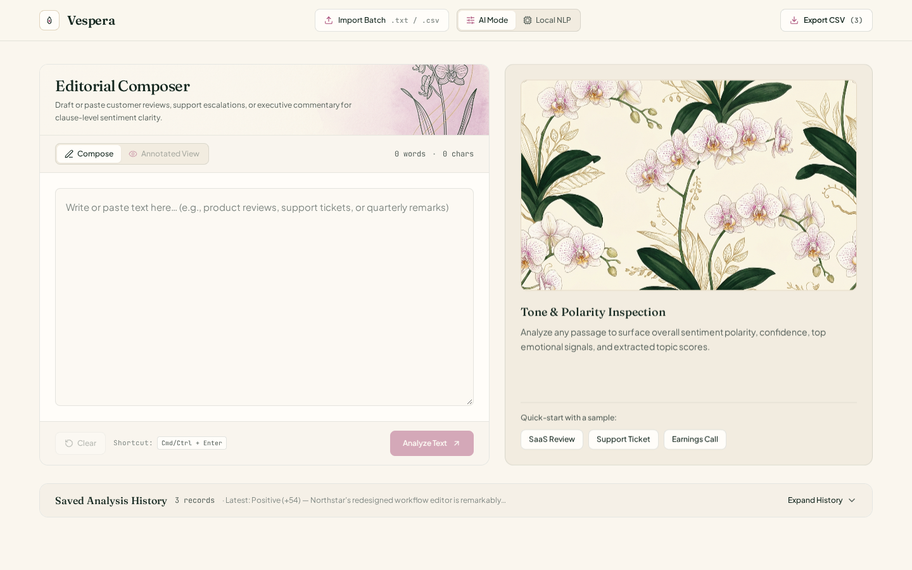
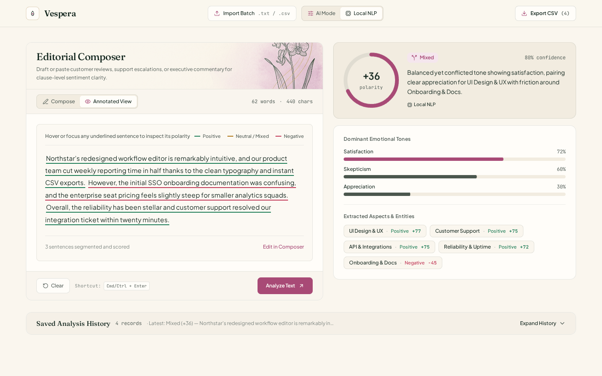
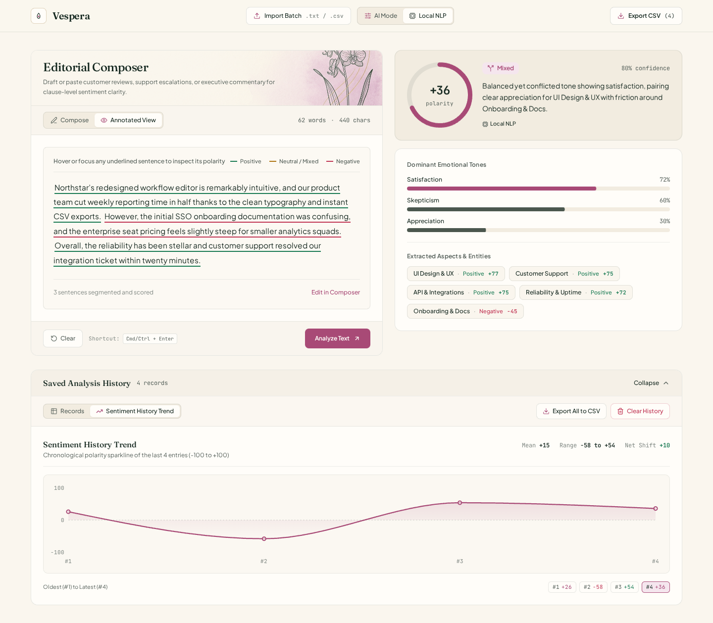

# Vespera — Sentiment & Text Intelligence

**Vespera** is an editorial sentiment and text intelligence web application crafted around a warm cream, deep forest-ink, and subtle orchid palette. It pairs a structured server-side analysis endpoint with a deterministic client-side NLP fallback engine, clause-level sentence annotations, batch `.txt`/`.csv` processing, interactive trend visualization, persistent `localStorage` history, and RFC-4180 CSV export.

---

## Screenshots

### Workspace & Standby View


### Annotated Reader & Executive Breakdown


### Sentiment History Trend Sparkline


---

## Key Features

- **Editorial Composer & Annotated Reader**
  - Distraction-free text composer with live word and character counters (`JetBrains Mono`, tabular numerals) and `Cmd/Ctrl + Enter` quick analysis.
  - **Annotated View** highlights individual sentences with semantic underlines (`Positive`, `Neutral / Mixed`, `Negative`) and updates a pinned Sentence Inspector readout on hover or keyboard focus.
- **Executive Polarity & Aspect Breakdown**
  - Animated SVG radial polarity gauge (`-100` to `+100`) with confidence percentage, semantic verdict indicator, and a one-sentence executive summary.
  - Top 3 dominant emotional tone micro-bars and extracted topic/entity polarity scores.
  - Quick-start sample presets (*SaaS Review*, *Support Ticket*, *Earnings Call*) in the standby view.
- **Hybrid Analysis Engine (`AI Mode` + `Local NLP`)**
  - **AI Mode**: Routes requests through an Express `/api/analyze` endpoint using structured JSON schema output, automatically falling back to the local NLP engine if the server key is absent or unreachable.
  - **Local NLP**: Instant, zero-dependency deterministic analyzer supporting negation windows (`"not great"`), degree intensifiers/diminishers (`"extremely"`, `"slightly"`), contrast conjunction weighting (`"but"`, `"however"`), aspect extraction, and sentence-level polarity.
- **Batch File Import (`.txt` / `.csv`)**
  - Upload `.txt` (paragraph or line separated) or RFC-4180 `.csv` files directly from the top bar to analyze up to 25 entries per batch with live progress tracking.
- **Collapsible History Drawer & Recharts Trend Sparkline**
  - Starts collapsed at the bottom of the workspace and expands on click.
  - **Records Tab**: Sentiment filter tabs (`All`, `Positive`, `Neutral`, `Negative`, `Mixed`), live snippet/topic search, single-click row inspection, individual delete, and two-step clear confirmation.
  - **Sentiment History Trend Tab**: Interactive **Recharts** area sparkline plotting the last 10 polarity scores chronologically (`-100` to `+100`) with mean, range, net shift metrics, and hover tooltips.
- **Local Persistence & RFC-4180 CSV Export**
  - Pre-seeded with 3 realistic sample records on first load and automatically persisted in `localStorage`.
  - One-click export downloads `vespera-sentiment-history.csv` with proper RFC-4180 quote and newline escaping.

---

## Tech Stack

- **Frontend**: React 19, TypeScript, Vite 8, Tailwind CSS v4
- **Motion & Data Visualization**: `motion`, `recharts`, `lucide-react`
- **Backend**: Express 4 (`server.ts`), `dotenv`, `tsx`
- **Typography**: `Fraunces` (editorial display), `Plus Jakarta Sans` (UI & prose), `JetBrains Mono` (tabular scores & timestamps)

---

## Getting Started

### 1. Install Dependencies

```bash
npm install
```

### 2. Configure Environment (Optional for AI Mode)

Copy `.env.example` to `.env` if you want to enable server-side **AI Mode** alongside **Local NLP**:

```bash
cp .env.example .env
```

Set `GEMINI_API_KEY` in `.env`. Without a key configured, Vespera operates seamlessly via its built-in **Local NLP** engine.

### 3. Run in Development

```bash
npm run dev
```

The Express + Vite development server starts on `http://localhost:3000`.

### 4. Type Check & Production Build

```bash
npm run lint
npm run build
```

---

## Available Scripts

| Script | Description |
| --- | --- |
| `npm run dev` | Starts the Express + Vite middleware dev server on port 3000 via `tsx` |
| `npm run build` | Builds the production frontend bundle into `dist/` |
| `npm run lint` | Runs TypeScript type-checking (`tsc --noEmit`) |
| `npm start` | Starts `server.ts` |
| `npm run clean` | Removes `dist/` and compiled server artifacts |

---

## Project Structure

```text
├── docs/
│   └── screenshots/           # Application screenshots referenced in README
├── server.ts                  # Express server, /api/health & /api/analyze endpoints
├── index.html                 # HTML entry point & Google Fonts configuration
├── src/
│   ├── App.tsx                # Main asymmetric workspace & state orchestration
│   ├── index.css              # Cream, forest-ink & orchid design tokens
│   ├── types/sentiment.ts     # Core TypeScript domain interfaces
│   ├── data/presets.ts        # Sample presets & first-load seeded history
│   ├── services/
│   │   └── analyzeService.ts  # Hybrid single & batch analysis orchestrator
│   ├── utils/
│   │   ├── offlineNlp.ts      # Deterministic local NLP scoring engine
│   │   ├── batchImport.ts     # .txt and RFC-4180 .csv batch file parser
│   │   ├── csvExport.ts       # RFC-4180 CSV serializer & download trigger
│   │   └── storage.ts         # localStorage persistence helper
│   └── components/
│       ├── TopBar.tsx         # Brand header, batch uploader, mode switcher & CSV export
│       ├── ComposerPanel.tsx  # Text composer & interactive Annotated View
│       ├── ResultsPanel.tsx   # Polarity gauge, verdict, emotion bars & aspect breakdown
│       └── HistoryDrawer.tsx  # Collapsible history table & Recharts trend sparkline
```
